 

I'm **Visagan G** (**@Visagan2007**, he/him). I build across web, mobile and low-level systems.
My projects cover hackathon tooling, AI-powered analysis, mobile apps and cryptographic experiments.

<table>
<tr>
<td>

</td>
<td>

</td>
</tr>
<tr>
<td>

</td>
<td>

</td>
</tr>
</table>

  

  

 

|  |  |
|---|---|
| **Organizations** | [HackPack Club](https://github.com/HackPackClub) and [hackpack-gitstarted](https://github.com/hackpack-gitstarted) |
| **Timezone** | UTC +05:30 (India) |
| **Focus** | Web development, mobile apps, open source |

 

  

 

[**All repositories**](https://github.com/Visagan2007?tab=repositories) &nbsp;/&nbsp; [**Find me on GitHub**](https://github.com/Visagan2007)

