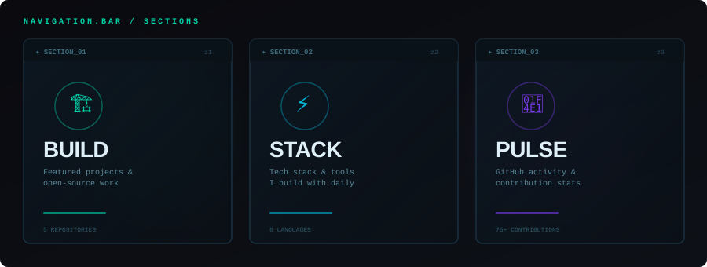
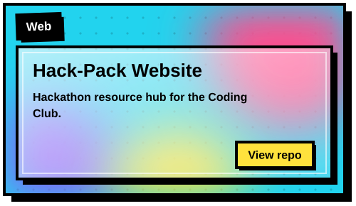
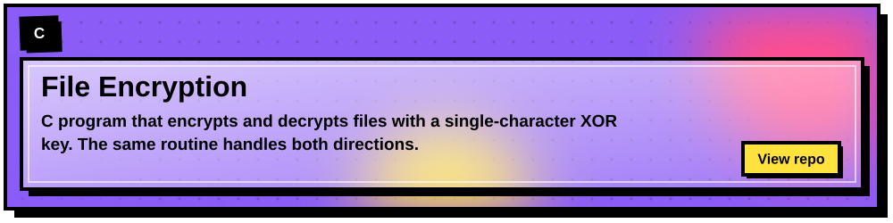

<div align="center">

<!-- ═══════════════════════════════════════════════════════════════ -->
<!-- HERO BANNER -->
<!-- ═══════════════════════════════════════════════════════════════ -->



<br/>

<!-- BIO -->

I'm **Visagan G** — **@Visagan2007** · he/him. Building across web, mobile & low-level systems.
My projects span hackathon tooling, AI-powered analysis, mobile apps & cryptographic experiments.

<br/>

<!-- ═══════════════════════════════════════════════════════════════ -->
<!-- SECTION NAV CARDS -->
<!-- ═══════════════════════════════════════════════════════════════ -->




</div>

<!-- ═══════════════════════════════════════════════════════════════ -->
<!-- SELECTED BUILDS -->
<!-- ═══════════════════════════════════════════════════════════════ -->

## `> Selected builds_`

<div align="center">
<table>
<tr>
<td>

<a href="https://github.com/Visagan2007/Coding-Club-Hack-Pack-Website">

</a>

</td>
<td>

<a href="https://github.com/Visagan2007/Resume-Skill-Analyser">

</a>

</td>
</tr>
<tr>
<td>

<a href="https://github.com/Visagan2007/Sabari-s-Nest-App">

</a>

</td>
<td>

<a href="https://github.com/Visagan2007/Tour-Website">

</a>

</td>
</tr>
</table>

<a href="https://github.com/Visagan2007/File-Encryption-Decryption">

</a>

</div>

<br/>

<div align="center">

[**HACK-PACK**](https://github.com/Visagan2007/Coding-Club-Hack-Pack-Website) · Hackathon resource hub &nbsp;&nbsp;/&nbsp;&nbsp; [**RESUME ANALYSER**](https://github.com/Visagan2007/Resume-Skill-Analyser) · AI skill gap analysis &nbsp;&nbsp;/&nbsp;&nbsp; [**ENCRYPTION**](https://github.com/Visagan2007/File-Encryption-Decryption) · XOR cipher engine


</div>

<!-- ═══════════════════════════════════════════════════════════════ -->
<!-- TECH STACK -->
<!-- ═══════════════════════════════════════════════════════════════ -->

## `> Tech stack_`

<div align="center">

```
╔══════════════════════════════════════════════════════════════════╗
║  SYSTEM.CONFIG / TECH_STACK                          status: OK ║
╠══════════════════════════════════════════════════════════════════╣
║                                                                  ║
║   LANGUAGES    ►  HTML · CSS · JavaScript · Dart · C             ║
║   FRAMEWORKS   ►  Flutter · Node.js                              ║
║   TOOLS        ►  Git · GitHub · VS Code · Android Studio        ║
║   DOMAINS      ►  Web Dev · Mobile Dev · Cryptography            ║
║                                                                  ║
╚══════════════════════════════════════════════════════════════════╝
```

<br/>

#### `// languages`


#### `// frameworks & tools`


</div>

<!-- ═══════════════════════════════════════════════════════════════ -->
<!-- GITHUB STATS / PULSE -->
<!-- ═══════════════════════════════════════════════════════════════ -->

## `> Activity pulse_`

<div align="center">


<br/><br/>


<br/><br/>


</div>

<!-- ═══════════════════════════════════════════════════════════════ -->
<!-- CONNECT -->
<!-- ═══════════════════════════════════════════════════════════════ -->

## `> Connect_`

<div align="center">

[](mailto:vizg.2007@gmail.com)
[](https://github.com/Visagan2007)

<br/>

|  |  |
|---|---|
| 🏢 **Organizations** | [HackPack Club](https://github.com/HackPackClub) · [hackpack-gitstarted](https://github.com/hackpack-gitstarted) |
| 🕐 **Timezone** | UTC +05:30 (India) |
| 🎯 **Focus** | Web Development · Mobile Apps · Open Source |

<br/>


<br/><br/>

<!-- FOOTER -->



<br/>

[**All repositories**](https://github.com/Visagan2007?tab=repositories) &nbsp; · &nbsp; [**Find me on GitHub**](https://github.com/Visagan2007)

<br/>

```
> system.exit(0)
> goodbye, world_
```

</div>
